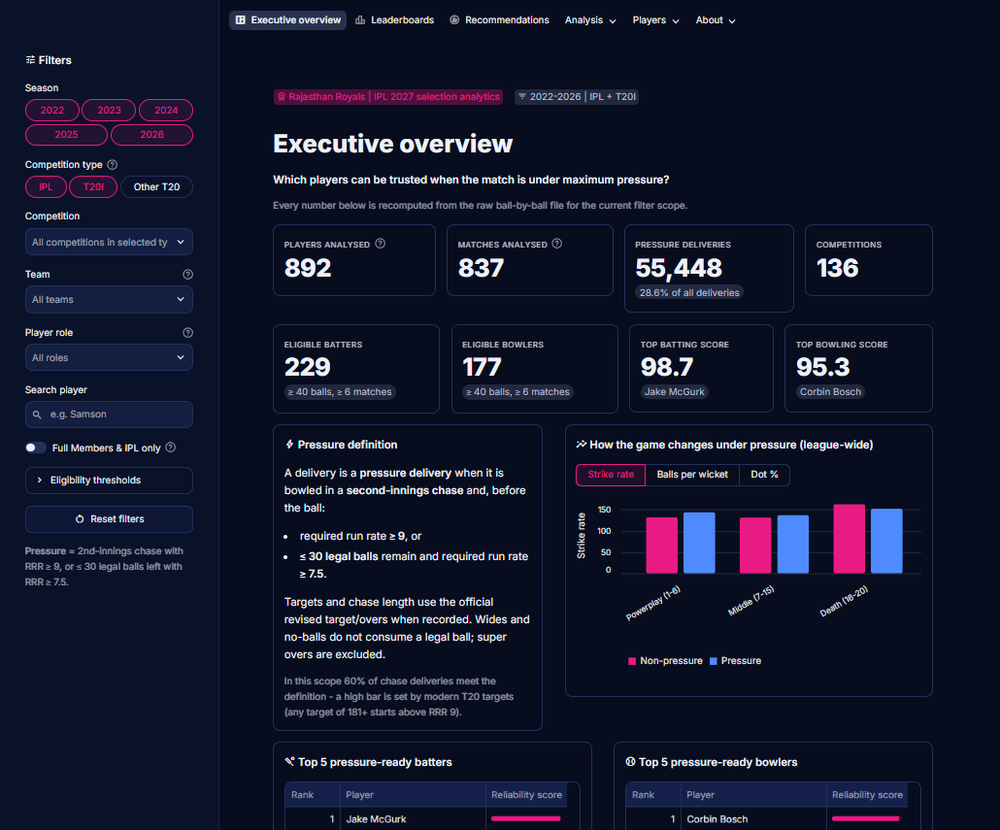

# Rajasthan Royals IPL 2027 - Pressure Performance Analytics

An interactive Streamlit dashboard that answers one question for the SupeRR Selector Season 2 challenge:

> **Which players can be trusted when the match is under maximum pressure?**

Every number is computed at runtime from the supplied ball-by-ball data pack (IPL and men's T20I, 2022-2026).
Nothing analytical is hard-coded.



## What it does

| Page | Contents |
|---|---|
| Executive overview | 8 KPI cards, pressure definition, league-wide pressure vs non-pressure rates by phase, top-5 previews, season trend |
| Leaderboards | Top-10 / all eligible / limited-sample batters and bowlers, sortable, searchable, bootstrap top-10 stability, CSV export, click-through to profile |
| Recommendations | Rule-based shortlists (best, most consistent, high-impact, limited-sample watch list, value picks) with evidence text |
| Batting / Bowling under pressure | Score composition, sample-size and rate scatters, consistency, full metric tables |
| Pressure vs normal | Pressure vs usual scatter with y = x reference, biggest risers and fallers |
| Teams & competitions | IPL vs T20I, by team, by competition, season trends, role distribution |
| Player profile | Pressure vs usual cards, bootstrap interval, match log, phase breakdown |
| Compare players | 2-6 players side by side (table + charts) |
| Methodology & validation | Definitions, formulas, live validation checks, rank stability, sensitivity analysis, limitations |

Global sidebar filters (season, competition type, competition, team, role, player search, Full Members & IPL only,
eligibility thresholds, reset) apply to every page.

## Pressure definition

A delivery is a pressure delivery when it is bowled in a **second-innings chase** and, before the ball:

- required run rate **>= 9.0**, or
- **<= 30 legal balls** remain and required run rate **>= 7.5**.

Revised targets and overs are used when recorded. Full details: [docs/METHODOLOGY.md](docs/METHODOLOGY.md).

## Scoring (percentiles within each discipline, eligible players only)

- **Batters:** 55% pressure SR + 25% pressure-vs-usual SR uplift (clipped to +/-40) + 20% boundary-ball %
- **Bowlers:** 45% inverse pressure economy + 35% wickets per 6 legal balls + 20% dot-ball %
- **Eligibility:** >= 40 pressure balls in >= 6 matches. The score is a 0-100 index, not a probability.

## Run locally

```bash
python -m venv .venv
# Windows: .venv\Scripts\activate    macOS/Linux: source .venv/bin/activate
pip install -r requirements.txt
streamlit run streamlit_app.py
```

Open http://localhost:8501.

## Validate and test

```bash
python scripts/validate.py        # independent recomputation -> docs/DATA_VALIDATION.md, docs/top10_*.csv
pip install -r requirements-dev.txt
python -m pytest tests -q         # headless UI tests for every page and filter
```

## Deploy

Streamlit Community Cloud (free): see [docs/DEPLOYMENT.md](docs/DEPLOYMENT.md). Entry point: `streamlit_app.py`.

## Project structure

```
streamlit_app.py          entry point: page config, navigation, global filters
app_pages/                one file per dashboard page
src/config.py             every threshold and weight (single source of truth)
src/data.py               loading, cleaning, joins, delivery-level pressure tagging
src/metrics.py            aggregation, eligibility, scoring, bootstrap, recommendations
src/state.py              Streamlit caching and filter state
src/ui.py                 charts, table configs, CSV export, light CSS
data/                     the supplied CSV files (loaded with relative paths)
scripts/validate.py       independent validation report
tests/test_app.py         AppTest UI tests
docs/                     methodology, validation, deployment, checklist, screenshots
.streamlit/config.toml    Rajasthan Royals dark theme
```

## Data notes

- Super overs (innings 3-4) are excluded; 16 abandoned matches have no ball-by-ball data.
- `extras_type = 'other'` behaves as a no-ball in the file and is treated as one.
- Player identity uses `player_id` (three names map to two IDs each and are disambiguated by team).
- Roles are derived from playing patterns, not official designations.
- No squad-availability, fitness or auction claims are made. "Latest IPL squad" is taken verbatim from
  `competition_team_player_mapping.csv`.
